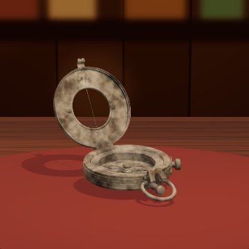
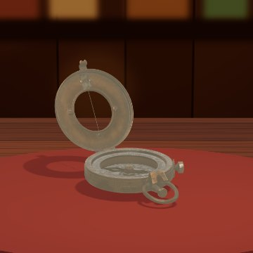
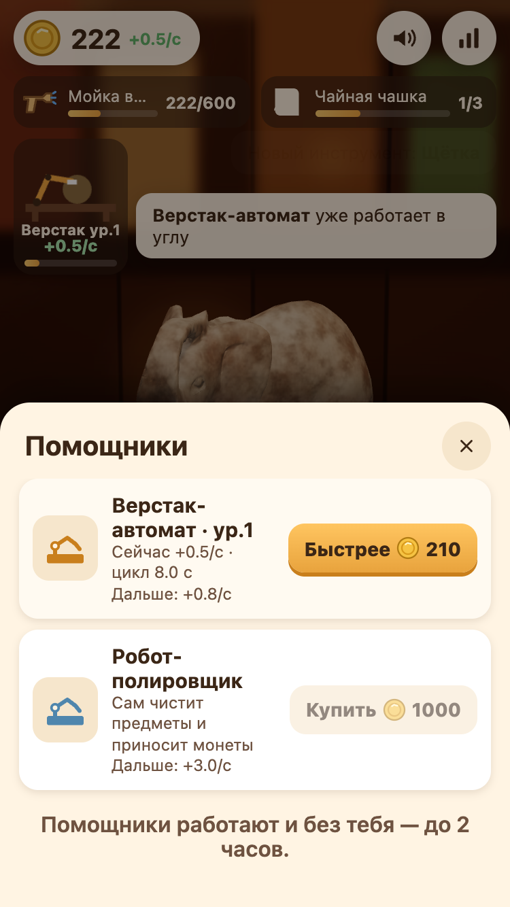

# Shine Shop — отчёт о прототипе

## «До / после»

| 375×667 | 430×932 |
|---|---|
|   |   |

Экран финиша: [375×667](screenshots/375x667-03-before-after.png), [430×932](screenshots/430x932-03-before-after.png).

## Экраны (375×667)

| Первый запуск | Чистка | Магазин | Помощник в углу |
|---|---|---|---|
|  |  |  |  |

| Помощники | Коллекция | Статистика | Офлайн-доход |
|---|---|---|---|
|  |  |  |  |

Скриншоты сняты `node scripts/shots.mjs` (системный Chrome, эмуляция телефона с касаниями, DPR 2):
чистка жестами, покупка щётки и верстака, 4 предмета, альбом, статистика, выход и возврат через 3 часа.
Ошибок в консоли — нет.

## `npm run sim` (seed 42)

```
 время  | покупка                      |  цена | доход помощников
--------+------------------------------+-------+-----------------
 01:35  | Щётка                        |    55 | 0.0 мон/с
 03:17  | Верстак-автомат              |   130 | 0.5 мон/с
 04:55  | Верстак-автомат ур.2         |   210 | 0.8 мон/с
 06:10  | Верстак-автомат ур.3         |   315 | 1.1 мон/с
 07:53  | Верстак-автомат ур.4         |   473 | 1.7 мон/с
 10:02  | Мойка высокого давления      |   600 | 1.7 мон/с
 11:41  | Верстак-автомат ур.5         |   709 | 2.5 мон/с
 13:19  | Робот-полировщик             |  1000 | 5.5 мон/с
 14:55  | Верстак-автомат ур.6         |  1063 | 6.8 мон/с
 16:02  | Робот-полировщик ур.2        |  1400 | 8.1 мон/с
 17:54  | Верстак-автомат ур.7         |  1595 | 10.0 мон/с
 19:39  | Робот-полировщик ур.3        |  2240 | 12.0 мон/с
 20:37  | Верстак-автомат ур.8         |  2392 | 14.9 мон/с
 22:37  | Лазер                        |  3200 | 14.9 мон/с
 24:44  | Робот-полировщик ур.4        |  3584 | 17.7 мон/с
 26:33  | Верстак-автомат ур.9         |  3588 | 22.0 мон/с
 28:51  | Верстак-автомат ур.10        |  5382 | 28.4 мон/с

Первые 15 минут: 9 покупок, интервалы (с): 96, 101, 99, 75, 103, 128, 99, 99, 95, 5
Средний интервал: 99 с, максимальный: 128 с
По 200 сидам: цель выполнена в 200/200, худший интервал 163 с
```

Модель игрока в sim: время чистки = f(грязь, ржавчина, мощность инструмента) + 5 с на финиш/продажу,
жадные покупки самого дешёвого улучшения. Скины в sim не покупаются (косметика).

## Проверки

- `npm test` — 38 тестов (экономика, редкость и мешок золотых 1/20, офлайн-кап 2 ч, SaveService и миграция, лог, альбом, без повторов, темп sim).
- Сборка: `dist` 8.9 МБ (лимит 15 МБ), из них модели ~8 МБ: 26 предметов Poly Haven CC0 (meshopt + webp 1k), реальный масштаб.
- Точность процента: если очистить случайные 94 % видимых текселей, прогресс = 94.0–94.1 %; если все видимые — ровно 100 %,
  и предмет чистый со всех сторон (видимость считается id-рендером на GPU с 40 направлений).
- Производительность (Mac, headless Chrome, без лимита кадров, 430×932 @2x, непрерывная чистка):
  монета ~1000 fps, фонарь ~200 fps, фотоаппарат ~350 fps; 3D-кисть ≈ 0.5 мс/кадр.
  На телефоне не мерилось — на слабом устройстве pixel ratio сам снижается с 2 до 1 при < 50 fps.
